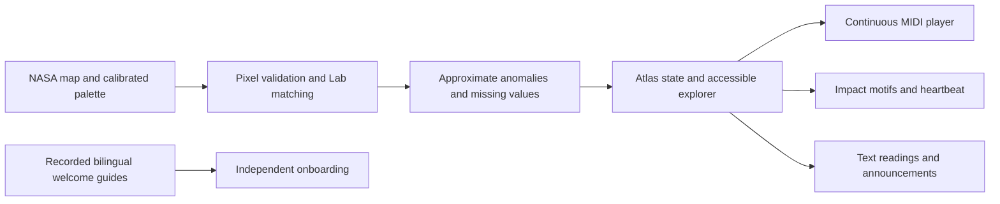

# Architecture and maintenance

## Runtime

PulsoTerra is a static browser application using HTML, CSS, JavaScript, Canvas 2D, browser audio elements, and the Web Audio API. It has no application backend, account requirement, or runtime AI service. Language, typography, contrast, and text-size preferences use browser-local storage. A static server supplies files; processing and interactive audio run in the browser.

## Main files

| Path | Responsibility |
| --- | --- |
| `dist/index.html` | Current application shell, welcome, semantic controls, and script order |
| `dist/atlas-app.js` | Current interaction state, map selection, audio orchestration, and explorer API |
| `dist/pixels.js`, `dist/anomaly-analysis.js` | Color validity, palette inversion, medians, histograms |
| `dist/geography.js`, `dist/assets/geocountries.js` | Projection/orientation, named regions, approximate boundaries |
| `dist/vivaldi-score.js`, `dist/vivaldi-player.js` | Prepared score, continuous playback, smooth parameter changes, original comparison |
| `dist/sonification-policy.js` | General pitch, mode, heartbeat, and variety policy with references |
| `dist/atlas-audio.js`, `dist/sound-bank.js` | Sample playback, category motifs, tension, mixing, and heartbeat |
| `dist/accessible-explorer.js` | Draft selectors, explicit querying, readings, playback actions, focus preservation |
| `dist/i18n*.js`, `dist/*-content.js` | Translation dictionaries and narrative content |
| `dist/alien-host.js`, `dist/guide.js` | Welcome transition and silent animated characters |
| `dist/welcome-audio*.js`, `dist/welcome-audio.css` | Recorded instructions, transcripts, and playback controls |
| `dist/accessibility*.js`, `dist/accessibility.css`, `dist/font-preference.js` | Low-vision/font preferences and accessible presentation |
| `dist/assets/` | Maps, palette, score, samples, records, videos, font, and credits |
| `tests/` | Node behavioral checks and optional Python source-image integrity checks |
| `tools/` | Tracked preparation helpers; not all tools need to run for a fresh clone |

`dist/version-anterior.html`, `sonidos-anterior.html`, `app.js`, and `audio.js` include retained earlier implementation material. They are not the architecture entry point for the current atlas. Retained source-engine copies in the audio license directory document the material they reproduce; do not overwrite them with new engine code.

## State and accessible controls

The current app exposes `window.PulsoExplorer` with snapshots, subscription, map/category selection, year selection, inspection, listening, tour, and pause operations. `accessible-explorer.js` consumes this API rather than manufacturing a second climate dataset. The five query fields hold drafts. A form revision prevents a completed asynchronous operation from overwriting more recent edits. Request identity and collection/detail guards discard stale results. Native controls are not replaced during focused use.

The reading text and map state can advance during a tour without overriding drafted query fields. Check this area explicitly applies the current draft. Detailed readings, short announcements, and optional follow mode have separate roles to avoid continuous screen-reader chatter.

## Audio boundaries

The geographic player preserves one score position and changes its playback parameters. Impact tours use sequenced category events. The heartbeat is independently enabled and mixed. The welcome uses a single HTML audio element outside the inert application surface. It is stopped before the welcome is dismissed, preventing instruction/music overlap. Browser interaction is required to start sound.

## Translation and generated output

The translation layer retains Spanish source text and translates to English using the dictionaries loaded before initialization. Protected content such as transcripts carries `data-no-i18n` and explicit language tags. The welcome transcript JSON generates `welcome-audio-content.js`; edit the JSON, not just the generated output.

`build-offline.mjs` embeds styles, fonts, scripts, score, maps, videos, branding, records, audio samples, and instruction recordings. Its callback-based script replacement is deliberate: literal replacement sequences such as `$&` inside source code must survive unchanged. Test the offline result after adding any new asset type.
